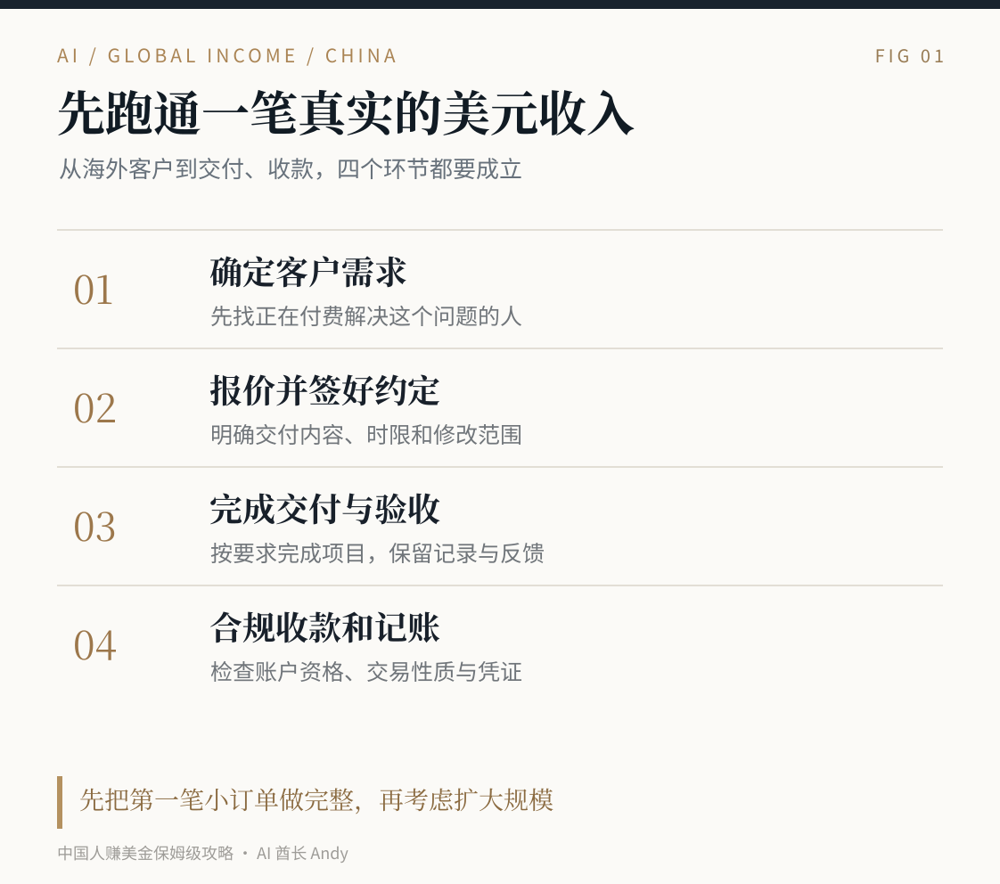
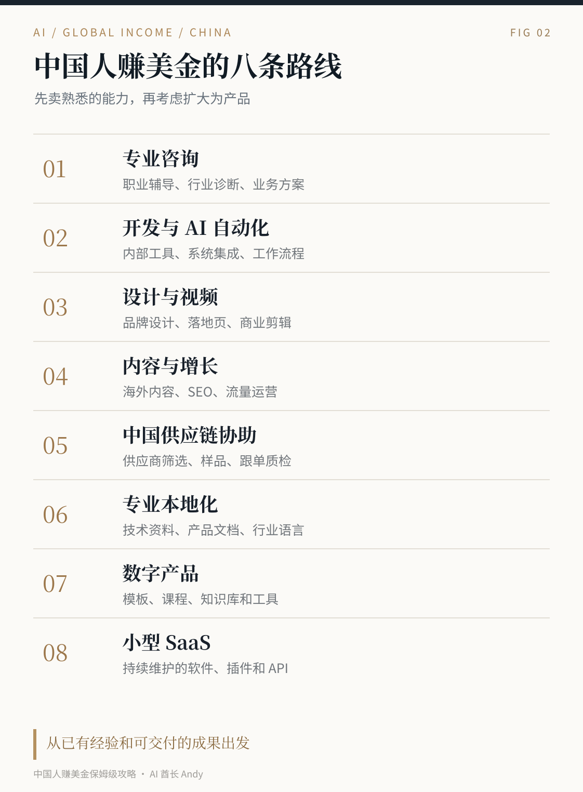
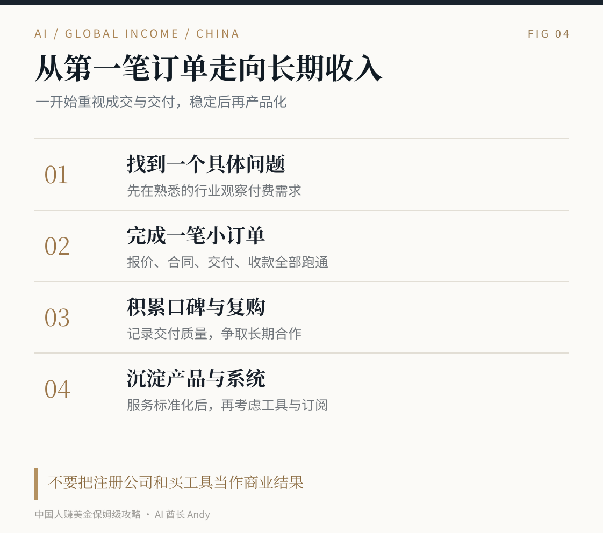

# 中国人赚美金保姆级攻略

**一个中国人，一台电脑，怎样从第一笔美元收入走向长期海外生意**

我最近一直在研究怎么把国内已经会做的事情，直接卖给海外客户。

以前做 AI 产品，客户主要在国内。后来做职业咨询、内容、开源项目，又开始研究 X、Threads 和 GitHub。我发现有意思的一点，很多人在国内已经有十年的专业经验，却从来没想过这项能力在海外有没有人付钱。还有一些人忙着研究美国公司、银行卡、支付工具，折腾很久，却连第一位客户都没有。

所以这次我把中国人赚美金的路径拆开了。什么生意可以做，哪些渠道能找到客户，怎么报美元价格，如何把项目交付好，钱怎么合法收到国内，什么情况下需要公司，税务怎么处理。

我先说自己的判断。**最适合普通人起步的是卖已经掌握的服务，再把反复交付的服务做成产品。** 有技术就卖技术，有设计能力就卖设计，懂运营就帮助客户增长，懂中国供应链就帮助海外商家采购。别为了赚美元，先去学一个完全陌生的行业。

海外客户也不是人人都愿意高价买单。我们能做成的生意，要同时具备四个条件。客户真的需要、我们能按要求交付、客户愿意付款、收款和税务可以走通。

## 一、先分清楚，赚美元到底是在赚什么

同样收到 100 美元，可能是五种完全不同的收入。

第一种，客户雇你提供服务。例如美国的小公司支付 300 美元，请你改一个网站页面。你收的是服务费。

第二种，客户购买你的产品。例如你卖一份 29 美元的招聘面试资料，或者一款每月 19 美元的工具。你收的是商品或软件收入。

第三种，海外企业付你工资或者长期合同费用。你收的是劳动报酬或承包服务收入，双方的劳动与税务安排需要核对。

第四种，平台付内容收益或联盟佣金。你赚的是平台广告、赞助、推荐分成。它依赖平台资格和规则，波动很大。

第五种，做跨境货物生意，把国内商品销售到海外。你赚的是销售收入减去采购、物流、平台、税费和售后的差额。

我建议普通人先做第一种。技术、设计、运营、咨询、翻译、本地化、供应链协助这些服务，不需要先囤库存，拿到客户订单后就可以安排交付。已经有企业与产品经验的人，甚至可以直接从第三种或更高单价的企业项目开始。

这里别把收入和利润混了。客户支付 100 美元，平台抽佣、换汇、退款、软件订阅、人工时间、税费都会影响实际收入。**能收到钱，是一回事。最终留下多少钱，是另一回事。**

## 二、我推荐的八条路线，先按自己原来的工作选择

| 路线 | 适合谁 | 卖什么 | 主要客户 | 起步优先级 |
|---|---|---|---|---|
| 专业咨询 | 产品、求职、行业专家 | 一次诊断、辅导、企业建议 | 海外华人、跨境企业、创业者 | 高 |
| 开发与 AI 自动化 | 开发者、AI 产品人员 | 网站、脚本、工作流、智能客服 | 中小企业、独立开发者 | 高 |
| 设计与视频制作 | 设计师、剪辑师 | 营销图、落地页、短视频 | 商家、内容团队、SaaS 公司 | 高 |
| 运营和内容服务 | 新媒体、SEO、增长运营 | 账号运营、客户内容、增长分析 | 创作者、海外品牌 | 高 |
| 中国供应链服务 | 外贸、采购、制造从业者 | 寻源、验厂、样品、跟单 | 海外电商卖家与进口商 | 高 |
| 本地化与翻译 | 双语从业者、行业专家 | 产品中文化、英文资料、市场研究 | 软件和消费品牌 | 中 |
| 数字产品 | 有专业资料或知识的人 | 模板、课程、资料库、小工具 | 有具体问题的人群 | 中 |
| 小型 SaaS | 能长期维护产品的小团队 | 订阅软件、插件、API 服务 | 有重复需求的企业 | 中长期 |

表里的优先级是我从交付难度和起步资金角度给出的判断，并非平台统计的成功率。下面我把每种业务讲具体。

### 01 做专业咨询，先卖一项自己熟悉的能力

我目前就在做 AI 应用和求职相关咨询。这条路的优点是可以沿用过去积累的知识，不需要写一套新软件。比如有人在海外工作，正在考虑进入 AI 行业，关心原来的制造、软件或管理经验怎么转型。你如果懂中国和海外相关行业的业务，就可以提供一次有明确产出的职业咨询。

适合卖的形式很简单。一小时交流、简历评估、一次产品方案评审、一个 AI 工作流程诊断。海外华人客户可以先用中文交付；海外企业则需要英文沟通材料。语言能力有要求，但你不需要等到英语接近母语水平才研究市场。

建议第一次销售时把服务范围写死。比如 45 分钟会议、会前一份问题清单、会后一页建议，价格由你的真实经验和客户反馈决定。下面所有美元报价都是**供设计产品时参考的测试档位**，不代表平台平均价格或保证成交。

### 02 做开发或 AI 自动化，优先接明确的小项目

很多海外小公司每天都在解决相同的麻烦。客户线索散在邮箱里，客服反复回答相同问题，Excel 要人工复制，网站数据和 CRM 连不起来。这些工作可以做成具体项目。

我更推荐先卖三类服务。**数据整理和报表自动化**，**网站和内部工具开发**，**基于已有资料的客服或知识助手**。客户给出现在的流程，你说明完成后的结果和验收方式。比如将客户提交的表单信息写进已有的 CRM，重复项目自动提醒，异常保留人工确认。

不要一上来承诺做一个完全自动运行的 Agent 部门。企业要看的首先是数据权限、稳定性和真实交付。做完一个小系统，后面还可以按月收维护费。

### 03 设计和视频制作，适合先用作品成交

海外客户买的是能拿去用的页面、海报、演示材料、视频。做设计的人先选一个细分场景，例如 SaaS 落地页、电子商务商品视觉、YouTube 封面、短视频剪辑。只放六到八件最能说明水平的作品，写清用户、用途和自己完成的部分。

AI 可以帮忙处理初稿、字幕和多尺寸输出。真正值钱的工作在信息准确、用户体验、品牌统一和交付速度。素材来源和授权也要能说明。你可以先在 Fiverr、Upwork 等服务市场测试需求，再把有明确需求的客户变成长期合作。

### 04 内容与增长服务，卖商业结果

这条路适合已经做过国内账号的人。国外企业同样需要内容选题、账号管理、SEO、用户研究、广告素材和邮件营销。但每个平台和语言市场的规则不同，不能把一套中文视频翻译完就当成海外运营。

最适合先卖的是范围清楚的服务，例如每月四篇行业内容、一套可发布的短视频、一个网站内容改版、一次账号诊断。交付时报告可验证的访问、点击、询盘或咨询数据。别用承诺“30 天涨粉一万”作为销售话术。

### 05 供应链服务，这是中国人的一项现实优势

很多海外小商家需要找产品、询价、核对样品、了解交期与工厂。懂工厂、懂质检、懂制造流程的人，可以帮助他们在中国完成本地采购工作。

你卖的可以是按项目收费的供应商调研、样品采购协助、生产进度核查、验货安排、出口资料整理。收货款、代理采购或参与货物贸易时，主体、合同、海关和税务要求要按真实业务设计。没有经验的人先从可控的资料整理和供应商信息核查做起。

这条业务背后的客户通常更看重稳定和诚信。供应商报价、质量报告、生产时间不准确，都会让你后面花很大代价。

### 06 做专业本地化，有行业知识比单纯翻译更有用

纯粹把中文翻译成英文，竞争已经很激烈。我更推荐懂产品的人做软件帮助文档、应用商店页面、技术资料和用户手册。翻译只是其中一步，你还要核对操作逻辑、功能命名和当地消费者能否理解。

一个懂 AI 产品的中国从业者，可以帮助国外软件了解中国市场；一个懂中国制造业的人，可以帮助中国企业把产品资料整理成海外采购员能理解的版本。专业知识是竞争力的来源。

### 07 卖数字产品，先有客户问题再做商品

内容模板、工具脚本、专业清单、课程和知识库确实可以卖美元，但刚开始往往没有流量。我不建议先花一个月录课，再研究有没有人买。更好的顺序是先卖咨询和服务，发现客户总问同一类问题，再把一部分答案沉淀为资料。

例如一位开发者经常帮助客户解决某种自动化问题，可以做一套部署模板。一个求职顾问经常被问某类岗位面试，可以整理成资料库。定价可以测试 9、29、99 美元等不同档位，但每个价格都应对应清楚的交付内容。选择销售平台前，先确认**中国大陆身份能否注册、完成实名验证、提现到可用的账户**。

### 08 做 SaaS，把重复服务变成持续收入

如果你已经有客户反复提出相同需求，可以考虑做小型 SaaS。例如让跨境商家集中处理产品问答、帮小团队整理外贸询盘、给招聘团队生成结构化面试安排。产品应有可持续需求、明确的数据边界，以及愿意按月续费的客户。

一个 SaaS 并不会因为接了大模型就自动有人买。我通常会先看五件事，谁每周会用、原来怎么解决、能节约多少时间、客户愿意付多少、断了服务会有什么影响。有稳定客户以后再接支付订阅、做多语言支持和自动化营销。

## 三、客户究竟从哪里来，我建议按这四个渠道做

**第一，Upwork 和 Fiverr。** 这是有明确外包需求的平台。做服务的人先研究真实项目，再调整自己的作品与产品描述。Upwork 可以投与既有项目经验对应的工作，Fiverr 适合把服务标准化成几个套餐。Upwork 官方列出中国大陆本地人民币提现渠道，Fiverr 支持部分地区通过 Payoneer 等方式提现。具体资格仍看账户审核与显示。<https://support.upwork.com/hc/en-us/articles/211063888-How-to-withdraw-earnings-with-Direct-to-Local-Bank> <https://help.fiverr.com/hc/en-us/articles/360010530058-Withdrawing-your-earnings-managing-payout-methods>

**第二，LinkedIn。** 我觉得更适合企业服务。在职位、公司和人员中查到海外中小企业的产品负责人、运营负责人、创始人，先读公司业务，再联系真正可能需要你的客户。最忌讳群发一段“我们是最优秀的 AI 服务提供商”。你需要指出一个与对方实际业务有关的具体问题。

**第三，X、Threads 和行业社群。** 适合已经有内容能力的人。看谁在公开讨论真实问题，在评论里给出有用建议，再把完整经验整理成内容。客户对你建立基本认知以后，才有可能来私信。X 以前的 Creator Revenue Sharing 已在 2026 年 9 月停止，不能把旧分成计划当成今天的主收入方案。相关的 Original Content Rewards 另有资格和地区要求。<https://help.x.com/en/using-x/creator-revenue-sharing>

**第四，GitHub、个人网站与开源项目。** 开发者、产品人员适合把真实工作的部分方法公开。比如一个能运行的自动化工具、一份技术指南、一套经过验证的行业知识。别人看到你能处理实际问题，可以从项目说明里的业务联系入口找到你。GitHub 本身不会保证有人付钱，公开内容主要帮助建立信任。

这四个渠道不需要全部同时做。**接单市场负责发现明确需求，内容和网站负责建立信任，客户沟通负责成交。** 起步时选其中两个就够。

### 个人介绍应该怎么写

海外客户通常先看你能解决什么问题，再看你的职业头衔。

例如一个做 AI 工作流的人，介绍自己可以直接写成这样。

“I help small teams reduce manual work by connecting their forms, spreadsheets, CRM, and AI tools. I build practical workflows that your team can maintain.”

中文意思就是帮助小团队把表单、表格、CRM 和 AI 工具连起来，减少重复劳动，交付团队自己能维护的流程。

你也可以把方向写得更窄，例如只服务 Shopify 商家、只做 SaaS 的客户支持、只做求职转型咨询。越容易描述交付物，客户越容易判断能不能合作。

### 第一条私信怎样发

我建议不要一上来介绍自己全部的经历。先说你看到了对方什么问题，再说明你可以做什么，最后问对方是否愿意交流。

**英文示例**

> Hi Alex, I saw your team is handling customer requests across email and spreadsheets. I've worked on similar workflow problems. I can help organize incoming requests, flag exceptions, and keep your CRM updated. Would it be useful if I sent over a short outline?

这条消息只适合你确实看到对方有类似业务问题的场景。对方没有公开提过，就别装作自己已经研究过他们的内部流程。

### 给 Upwork 项目的提案怎么写

> Hi, I can help with your [specific task]. I would first confirm the inputs, required outputs, and access permissions, then build a small working version for your review. Once approved, I'll finish the integration, test failure cases, and provide handover notes. I can share a similar project if helpful.

投递时把方括号替换成真实项目，不要原封不动地群发。客户要的是能完成项目的人，文字短一些没关系。

## 四、报价怎么做，避免忙一个月只赚几十美元

我更建议初期卖明确的成果，等客户需要长期合作，再考虑包月。

下面是可以测试的**产品设计档位**，没有经过平台成交数据验证，不代表行业平均报价。

| 服务 | 可以测试的报价 | 对应交付 |
|---|---:|---|
| 个人职业咨询 | 49—149 美元 | 一次会议、一页建议、答疑范围 |
| 网站小修复 | 100—300 美元 | 一个明确问题、测试、交接 |
| 运营诊断 | 99—299 美元 | 现状分析、问题清单、建议 |
| 简单自动化 | 300—1,000 美元 | 流程、部署、验收、说明 |
| 中小企业流程改造 | 1,000—3,000 美元 | 多步骤项目、阶段性交付 |
| 长期维护服务 | 100—500 美元/月 | 限定次数与响应范围 |

报价以前先明确六件事。输入材料谁提供、项目包含哪些功能、客户在哪一步验收、需要修改几轮、额外需求如何计费、付款分几次。第一次合作可以采用小范围付费试单，后面按阶段付费。没有收到任何款项就先交全部源码或商业文件，风险很大。

**一个项目报价示例**

海外电商商家希望把站内咨询整理到 CRM。报价设为 600 美元，分三段进行。第一段 100 美元梳理流程与权限，第二段 300 美元完成基础功能，第三段 200 美元完成测试、文档和交接。这只是合同设计示例，并非真实客户成交案例。

合同里注明客户提供的数据和第三方订阅费用由谁承担，哪些服务在验收后停止，以及谁持有代码和知识产权。最好把范围写成一张可核对的清单。

## 五、钱怎么收回来，这一段必须先看

我把收款分成三种常见情况。**海外平台结算、海外客户直接付款、网站卖数字产品。** 这三种业务的账户要求和材料未必相同。

### 情况一，海外接单平台付款

如果通过 Upwork 成交，先完成平台身份认证，进入提现设置，看能用哪些方式。它的官方说明列出了中国本地银行人民币提现，通常也可能有 Payoneer 或 PayPal 等选项。不同币种和渠道会产生手续费与换汇成本。提现账户姓名要与验证资料匹配。

Fiverr 的提现方式包括部分账户可用的 PayPal、银行转账经 Payoneer、Payoneer 账户等，具体还受国家和账户条件限制。千万别先接了一大单，项目结束以后才发现自己提现不符合条件。

### 情况二，海外企业直接付款

如果已经有国内依法注册的公司，可以让客户通过银行国际汇款或符合企业资质的跨境支付渠道付款。最好使用正式合同、企业发票与企业账户，根据银行的真实交易审核提交服务内容、合同、发票及相关交付记录。

PayPal 中国提供面向中国商户的跨境人民币收款路径；Payoneer 也有面向合资格境内个人或商户的跨境贸易收款与结算服务。具体申请资格、业务范围和手续费以各自服务协议及账户为准。<https://www.paypal.cn/portal/merchant/rmb-transfer> <https://www.payoneer.cn/service-agreement/>

如果目前只是个人接一两次零散服务，也可以向自己的银行和平台确认符合真实业务的个人收款方式。业务连续发生、开始有长期客户后，建议尽早明确经营主体和税务处理。

### 情况三，网站卖软件或数字产品

这里很多人会碰到 Stripe。**Stripe 的正式支持国家与地区列表目前包括香港、美国等地，不包括中国大陆。** 不能因为自己有美国 IP，就填写一个没有真实权利使用的美国公司或地址。

部分数字商品平台提供代收付款，但注册地区、身份证明、可提款国家和支付方式会变化。Gumroad 明确不支持以 Payoneer 或 Wise 作为创作者提款替代方案；部分国家需要 PayPal 提现。Lemon Squeezy 等平台也要单独检查支持的卖家地区和提款条件，不能只看它们能收美国客户的信用卡。<https://stripe.com/global> <https://gumroad.com/help/article/223-payoneer-and-gumroad> <https://docs.lemonsqueezy.com/help/getting-started/supported-countries>

有人会考虑注册美国公司。它可能是业务发展的方案，但注册费只是一小部分。公司还有州年度费用、税务申报、银行要求、注册代理和维护成本。Stripe Atlas 官方目前标价 500 美元注册费，后续可能有每年注册代理等费用。**客户还没成交时，不建议先把时间都花在注册美国 LLC 上。** <https://stripe.com/atlas>

### 个人每年只能收 5 万美元吗

国家外汇管理局明确，等值 5 万美元是个人结售汇的**年度便利化额度**，并非真实合法的经常项目结汇金额绝对上限。超出额度或需要不占额度办理时，可根据具体交易提供真实材料。经营性外汇收支与普通非经营性收入要区分，不能把商业收款拆成家人多个账户来规避审核。<https://www.safe.gov.cn/ningxia/2022/0929/1997.html>

我建议第一笔海外业务就留好合同、发票或付款凭证、客户邮件、交付记录和账户流水。以后客户变多、业务金额变大，这些材料会直接影响收款效率。

## 六、税务怎么处理，赚美元也要算这笔账

先区分两个概念。**客户来自美国**，不意味着这笔钱在中国税务上必然属于境外来源所得。个人如果人在中国境内提供劳动、履约或服务，相关所得在适用规则下可能属于中国境内来源所得，和客户从哪里打款是不同的判断。个人所得税法实施条例第三条明确了在中国境内提供劳务的所得来源规则。<https://www.chinatax.gov.cn/n810219/n810744/n3752930/n3752974/c3963364/content.html>

你赚的是工资、劳务报酬、个人经营所得、稿酬还是公司营业收入，会影响申报方式。中国税收居民的境内外所得也要按适用规定处理。对于确实属于居民个人的境外所得，政策规定取得所得的次年 3 月 1 日至 6 月 30 日申报；经营所得还有不同申报与预缴安排。<https://www.chinatax.gov.cn/chinatax/n810219/n810744/n3752930/n3752974/c5143076/content.html>

企业出口软件、设计等服务，符合条件的业务有机会适用增值税零税率或跨境免税政策，但必须符合服务性质、境外消费、申报材料等具体要求，不能因为客户在美国就自动当成零税率。2026 年税务机关的相关解释可在官方渠道查到。<https://liaoning.chinatax.gov.cn/art/2026/7/13/art_782_172991.html>

我的建议非常实际。第一笔收入就单独记账。把付款主体、服务内容、订单金额、平台费用、实际到账、开票情况、发生地点与对应凭证记清楚。如果已经稳定经营，找了解跨境服务的会计核对主体和纳税事项。别通过虚报居住地、购买所谓免税账户来处理这件事。

## 七、怎么判断客户靠不靠谱

第一类风险是客户要求你先交钱才能接单，声称交保证金、买培训或预付税费后会得到高价海外工作。先核实平台和合同，别转账给陌生人的个人收款账户。

第二类是要求你在付款前做完整样品。正常的小型付费试单可以谈，免费把整个项目做完再看结果，风险太高。尤其是代码、设计源文件和客户名单。

第三类是要求用你的个人账户代收款、代转款，或者让你把钱转成加密资产寄给别人。这可能涉及非法资金或洗钱风险。业务应该有清楚的付款主体和合同。

第四类是未经客户授权，把商业秘密、用户数据上传公共 AI 服务。客户发现以后，丢掉的不仅是一单生意，还有长期信誉。

第五类是夸大能力。客户让你设计支付系统，你只会做几个网页，那就不要承诺。可以从能交付的功能做起，后续再扩大范围。

## 八、我认为比较可靠的起步方案

### 第一个阶段，先做一项能立即报价的服务

你已经做了五年产品，就把服务定位成产品诊断和 AI 工作流。做开发，就定位成自动化开发或网站维护。做设计，就定位成 SaaS 落地页或营销素材。不要同时做咨询、课程、SaaS、跨境电商和内容联盟，精力会被分散。

接下来做一页服务介绍，写上你服务谁、解决什么问题、客户会收到什么、怎么验收、价格怎么计算、通过什么方式联系。至少要有能展示真实能力的项目成果。没有客户案例，就用你自己的真实作品，注明它是个人作品。

### 第二个阶段，先让海外客户看到你的能力

选择一个有明确需求的平台，再选一个可以长期积累内容的渠道。例如 Upwork 加 GitHub、LinkedIn 加个人网站、X 加行业文章。把受众限定到你能理解的行业。

每天花一小段时间读真实需求，回应合适的项目，并把你的专业经验公开出来。一开始更重要的指标是有人回复、有人愿意开会、有人愿意付试单费。粉丝数、浏览量、收藏数可以看，但别用它们代替收入指标。

### 第三个阶段，跑通第一单的全部过程

一个真实订单至少要走完询价、合同、付款、交付、修改、验收、收款和记账。不要因为第一次交易金额小，就省掉交付确认和资金记录。

这件事跑完，你就有了接第二单的基础。客户提出的重复问题，决定你接下来该做什么产品。如果你连续交付同一类服务，逐渐形成标准化流程，再考虑雇人、订阅工具或者注册更合适的公司主体。

### 第四个阶段，从项目收入走向稳定收入

先让客户愿意介绍第二个客户。之后可以增加月度维护、长期内容运营、培训或订阅产品。服务型生意提高收入，主要靠更高质量的客户、可复用的方法和稳定的交付；产品型生意则要持续解决重复问题，并控制获取客户的成本。

## 九、结合我的情况，我会优先做这三种

我做过多年 B 端 AI 产品，也一直做职业咨询、AI 内容和 GitHub 开源项目。最近海外内容确实带来过求职转型和会员相关的业务线索。这说明中文职业能力、海外内容渠道和实际付费需求之间有机会打通，但线索最终能不能持续成交，还要继续做产品和交付。

**第一，面向海外华人的 AI 职业咨询。** 面向在欧洲、北美工作的华人，帮助分析 AI 岗位、产品职业、互联网社招和转型路线。它沿用原来的职业咨询经验，沟通和交付成本相对可控，可以先卖明确范围的一对一服务。

**第二，面向海外小团队的 AI 产品与工作流。** 我有 B 端产品、智能体、网站和业务流程方面的经验，可以帮企业诊断什么工作值得自动化，再交付一个能运行的实际方案。这里的关键是按阶段验收，不把技术演示当成完成项目。

**第三，继续做英文或双语内容和开源。** X、Threads、GitHub 可以持续发布真实经验，把文章和产品放到个人网站。开源负责展示方法和建立信任，内容负责吸引有需求的人，咨询与产品负责成交。三件事形成闭环以后，流量就有了商业价值。

如果你也是已经工作多年的人，我建议你从这三种模型里找到自己的对应版本。先把原有能力卖到新市场里，之后再想如何扩大规模。

## 十、一个月以后，我希望你拿到什么结果

我不建议用“一个月赚一万美元”这种数字给人打鸡血。第一阶段更有价值的结果，是你知道海外客户愿意为哪件具体事情付钱，手里有一项可报价的服务，收款和身份材料经过真实核对，完成了从沟通到交付的一整条链路。

如果还没有拿到订单，就继续看需求是否真实、作品是否匹配、服务是否足够明确、客户能否承担你的价格。这个时候修销售内容和产品，比换十个新平台更有用。

如果已经有第一单，就把客户最需要的交付流程整理出来，争取下一次做得更好。能连续交付、能收回钱、客户愿意再来，比一次高价订单更能说明生意开始成立。

**中国人赚美金的机会，最后还是来自自己的能力和客户愿意付款的实际问题。** 你不一定要搬去美国，也不必一开始就开美国公司。先找到需求、交付好、合法收钱，再让自己的服务慢慢走向全球。

## 十一、我替不同起点的人选好路线

我把常见起点分成七类。这个判断主要看你已有的工作经验、能拿出的作品，以及有没有时间承担交付。英语表达可以借助工具，但客户问题、专业判断和最终成果仍要自己负责。

| 你的情况 | 第一选择 | 第一件可以销售的东西 | 优先获客渠道 | 需要避开的坑 |
|---|---|---|---|---|
| 有工作的产品经理 | 产品诊断、AI 工作流咨询 | 一次业务流程梳理，交付问题清单和原型方案 | LinkedIn、行业社区、熟人介绍 | 还没了解行业就承诺自动化节省多少人力 |
| 程序员或 AI 开发者 | 小工具和自动化项目 | 指定输入输出的内部脚本、数据整理工具 | GitHub、Upwork、技术社区 | 不写维护边界就答应永久服务 |
| 设计师、视频剪辑师 | 固定范围的素材包 | 落地页、三支短片或品牌基础物料 | Fiverr、作品集、直接联系品牌 | 不约定修改次数和素材版权 |
| 内容运营从业者 | 内容策划、增长诊断 | 网站/账号诊断与一个月内容方案 | X、LinkedIn、行业内容 | 把播放量当成客户收入保证 |
| 熟悉外贸与制造 | 寻源、产品本地化和跟单 | 供应商名单、询价对照、样品协调 | 海外进口商、行业平台、已有业务网络 | 不核实资质就代作质量承诺 |
| 刚毕业，作品有限 | 明确边界的小型服务 | 简单排版、资料整理、合规使用的公开信息分析 | 平台小单、实习和公开作品 | 虚构客户背景和项目结果 |
| 已有受众或课程经验 | 服务带动数字产品 | 针对一个具体问题的模板或小型课程 | 自有内容渠道、Newsletter、社群 | 没人付费就投入数月开发 |

如果每天只有一两个小时，优先接交付范围明确、能够远程完成的服务。需要每天开会、随时响应、承担长期客服的项目，不适合随手当作副业。已经失业、急需现金流的人，还要把收入稳定性排在长期内容经营前面。

### 给三类人一个更明确的起步办法

**有五年以上经验的人。** 先把专业经验做成一项可交付的服务。做企业软件，就提供业务诊断、产品方案或 AI 工作流；做财务，就在专业资质允许的范围内提供经营数据梳理；做运营，就提供一次公开账号与网站诊断。第一件商品只解决一个问题。

**英语不熟练的人。** 先选择可以通过文件、留言和项目管理工具沟通的服务。英文邮件先自己写出核心意思，再用 AI 检查表达，重点核实数字、时间、价格、交付边界。涉及合同条款、法律承诺和资金支付，必要时请合格人员审核。

**没有公开案例的人。** 可以做自己的样例项目。例如开发者给开源项目做一个小功能，设计师给虚构品牌做一页视觉方案，运营人员分析一个公开账号并注明这是独立观察。把材料标记为个人作品，展示工作过程和可复现结果，不冒充真实客户订单。

## 十二、拿到第一笔美元订单，我建议按这七步做

这一章以远程专业服务为例。价格、日期都只是演示，不代表市场均价，也没有成交保证。

### 第一步，选一个付费理由明确的需求

先看客户已经在哪些场景花钱。比如网站加载太慢、客服回复占用大量时间、海外商品资料需要更新、企业想减少重复录入。你能说明问题带来的成本，也能说清自己可以交付的结果，这项服务才比较容易介绍给客户。

### 第二步，包装一个最小服务

不要一口气写出二十项能力。示例服务可以叫做“AI 客服知识库诊断”，包括一次线上会议、现有流程评估、一份风险清单、一套可运行的示例工作流，以及一次修改。约定客户提供经过授权的测试资料，不接入真实生产账号。时间按需求确定，超出的开发另行报价。

### 第三步，准备可以核验的作品

至少给客户看一个相关作品。作品页写清楚问题、输入资料、你的具体动作、输出文件和可以复现的结果。无法披露客户数据，就获得授权后匿名处理，或者使用标明为演示的样例材料。不要写未被验证的转化率、节省人力数字和成交金额。

### 第四步，用一个主要渠道接触客户

做专业咨询的人可以先从 LinkedIn、X 或行业联系人开始。开发者可以结合 GitHub 公开作品和适合的 Upwork 项目；设计者可参考 Fiverr 的服务商品化方式。检查平台支持国家、实名认证、费用和站内交易规则。只对确实相关的公开需求发送有针对性的回复，避免批量骚扰。

### 第五步，先确认范围，再报美元价格

询问客户的现有流程、输入资料、预期结果、交付日期、系统权限和验收方法。报价时把一次性的实施费用与后续维护区分。假设一个项目报价 300 美元，约定 50% 启动款、交付验收后付尾款，这只是谈单结构示例，实际合同应结合风险、平台规则和客户情况确定。

### 第六步，留下完整的交付与验收记录

起步前保存双方同意的工作范围、价格、版本、交付日和变更规则。交付时提供成果、使用说明、测试记录、已知限制和待确认事项。客户提出超出原范围的要求，先出变更报价，再开始做。涉及个人信息、支付、数据库与自动化写操作，必须得到明确授权。

### 第七步，按真实交易性质收款并处理税务

先确认交易主体与可用账户，再选择平台原生提现、合资格的跨境收款服务或银行路径。保存合同、发票或收据、付款通知、到账流水、交易说明及相关申报凭证。不同交易有不同分类和税务要求，必要时问银行与税务专业人士。不能为了“能收美元”虚构交易或借用他人名义。

**第一笔订单完成的标准。** 客户确认交付，约定款项真实到账，售后责任明确，交易材料完整。没有满足这些条件，就还不能把订单当成已经稳定赚到的钱。

## 十三、给你一份完整的 30 天安排

这是一份按天分工的示例计划。它安排的是你可以控制的动作，不保证第 30 天一定成交。兼职人员可以按每周投入时间调整节奏。

| 天数 | 做什么 | 当天应该留下什么 |
|---|---|---|
| D01 | 盘点已有能力和可投入时间 | 一张可交付能力清单 |
| D02 | 只挑一个行业和问题 | 目标客户画像与需求描述 |
| D03 | 研究公开的真实购买需求 | 五条有来源的客户问题 |
| D04 | 定义单一服务 | 服务名称、范围、不包含事项 |
| D05 | 确认能否合法交付 | 数据、版权、资质和权限检查 |
| D06 | 制作个人样例成果 | 第一版作品链接或文件 |
| D07 | 找同行或潜在客户看作品 | 修改意见和第二版作品 |
| D08 | 写一页英文服务说明 | 客户、问题、交付、时间、联系方法 |
| D09 | 设计固定价或分阶段报价 | 可复用报价表 |
| D10 | 准备收款路径和主体资料 | 平台资格及银行材料待办清单 |
| D11 | 整理 LinkedIn、GitHub 或作品集 | 一个真实完整的公开主页 |
| D12 | 找到十个匹配的公开需求 | 包含原始来源的潜在客户清单 |
| D13 | 写三份定制沟通草稿 | 三份针对不同问题的消息 |
| D14 | 选择合规渠道发出第一批回复 | 触达记录及后续跟进日期 |
| D15 | 根据反馈修改服务介绍 | 第二版服务页面 |
| D16 | 发布一篇真正帮助目标客户的内容 | 一篇文章或项目展示 |
| D17 | 研究客户最常问的价格和范围 | 常见问题与标准答复 |
| D18 | 对已回应客户确认需求 | 需求确认表 |
| D19 | 为真实需求准备对应的方案 | 具体交付清单与报价 |
| D20 | 检查合同、版权、付款条款 | 一份已审核的合同模板 |
| D21 | 跟进尚未答复的有效线索 | 一份不重复骚扰的跟进记录 |
| D22 | 优化演示项目与说明文档 | 可供客户验收的演示版本 |
| D23 | 根据回复率调整人群和渠道 | 渠道反馈摘要 |
| D24 | 用一次演示会议介绍作品 | 演示与提问记录 |
| D25 | 如果客户认可范围，发正式报价 | 报价、付款和验收约定 |
| D26 | 有订单则按约执行，没有则改进产品 | 交付进度或需求复盘 |
| D27 | 做质量检查和客户确认 | 测试与审核清单 |
| D28 | 整理合法收款及证明材料 | 文件归档与交易记录 |
| D29 | 向已合作客户确认后续服务需求 | 维护方案或复购线索 |
| D30 | 复盘有没有真正市场需求 | 继续、调整或暂停的明确决定 |

到第 30 天还没成交时，按顺序检查四件事。客户是否真的有预算，服务范围是否具体，作品是否能证明能力，渠道是否能接触到真正的决策者。不要因为没人回复就盲目加大私信数量，也不要把模拟订单写成成交故事。

## 十四、报价、交付和收款，我会提前准备的文件

一次远程服务至少应准备五份文件。

**服务介绍。** 写目标客户是谁、解决什么问题、客户最终拿到什么。避免“全行业、全流程、全自动”之类无法验收的承诺。

**报价与工作说明。** 包含币种、税费承担、里程碑、双方提供的资料、修改次数、交付时间、撤销或退款条件、知识产权归属。法律适用与争议处理要考虑双方实际司法辖区。

**客户授权。** 明确允许访问什么数据和系统、权限有效到什么时候、是否可以使用 AI 服务、哪些资料需要脱敏与删除。未经授权不操作客户真实后台。

**交付验收。** 确认已完成内容、测试方法、客户确认时间和遗留事项。功能类项目要有可复现的验收标准。

**交易凭证。** 按收入性质保存合同、收据或发票、平台结算单、银行流水、退款记录、手续费以及税务资料，按当地规定保存与申报。

可以直接打开仓库的 [报价模板](templates/service-quote.md)、[第一单清单](templates/first-order-checklist.md)、[资金凭证清单](templates/payment-records.md)，替换成自己的真实情况。英文沟通模板在 [这里](examples/outreach-messages.md)。

## 十五、我替你筛掉最容易失败的八种做法

**01 一开始就注册海外公司。** 有些业务后期确实需要海外主体，但没客户、没稳定需求时就花钱做架构，往往解决不了销售问题。先核对自己现有主体和交易模式是否可行。

**02 只研究支付工具。** 开通账户不等于完成销售。真实交易、平台资格、反洗钱审查和税务归类，任何一环都不能跳过。

**03 在所有平台同时发内容。** 同一个人管理十个平台，往往没有精力研究客户。先选一个主要获客渠道、一个公开作品入口。

**04 报价不写边界。** 客户只说“帮我做个 AI 系统”，你就报价，后面容易出现接口、数据、维护和无限改版争议。

**05 把 AI 输出当成可直接交付的商品。** 文案、设计和软件需要核对事实、授权、质量和适用场景。内容越容易批量生产，客户越看重最终交付。

**06 用未经授权的数据做样例。** 把真实客户名单、采购价格或员工资料上传公用工具，会产生商业秘密和个人信息风险。

**07 把案例和收入编漂亮。** 没有成交就标记为演示；没有客户许可就不要公开合同截图。用长期透明积累信誉。

**08 用平台流量推测稳定收入。** X、Threads、GitHub 能建立信任，但阅读数、Star 和粉丝增长不等于有订单。服务说明、联系入口和交付能力需要跟上。

我更关注长期可持续的业务。每周看真实询盘、有效沟通、报价、成交、交付、退款和净收入，而不是只看内容平台的热度。

## 十六、看完如果还拿不准，可以怎么联系我

我做过多年 B 端 AI 产品，也持续做职业咨询、AI 应用和开源内容。我的业务方向包括 AI 产品、职业转型、内容获客和海外项目。这里公开的攻略尽量把通用答案写完整。

如果你有现成的专业经验，但不知道如何包装成海外能够付费的服务；或者海外客户已经提出要求，你需要一起梳理报价、交付和 AI 解决方案，可以了解我的咨询与陪跑服务。

个人网站 [metaver.vip](https://metaver.vip/)；[咨询与陪跑服务](https://metaver.vip/services)。微信 **AIPMAndy**，添加时可以写一下你目前的行业和想解决的具体问题。

有可公开的真实案例、平台规则更新或文章错误，也欢迎直接到 [GitHub Issues](https://github.com/AIPMAndy/how-to-earn-usd-from-china/issues) 提交。请不要公开银行账户、客户身份、订单号等个人与商业敏感信息。

## 官方核查资料

这部分是正文涉及平台与资金规则的原始资料，供更新时核查。涉及开户资格、手续费和税务处理，具体以实际账户、业务性质和主管机构最新要求为准。

- [Upwork 中国地区本地银行提现](https://support.upwork.com/hc/en-us/articles/211063888-How-to-withdraw-earnings-with-Direct-to-Local-Bank)
- [Fiverr 提现方式](https://help.fiverr.com/hc/en-us/articles/360010530058-Withdrawing-your-earnings-managing-payout-methods)
- [Payoneer 中国跨境收款服务协议](https://www.payoneer.cn/service-agreement/)
- [PayPal 中国跨境人民币收款](https://www.paypal.cn/portal/merchant/rmb-transfer)
- [Stripe 官方支持地区](https://stripe.com/global)
- [Gumroad 创作者提款说明](https://gumroad.com/help/article/13-getting-paid)
- [X 创作者收益计划](https://help.x.com/en/using-x/creator-revenue-sharing)
- [外汇局个人额度解释](https://www.safe.gov.cn/ningxia/2022/0929/1997.html)
- [个人外汇管理办法](https://www.gov.cn/flfg/2007-01/09/content_491093.htm)
- [个人所得税法实施条例](https://www.chinatax.gov.cn/n810219/n810744/n3752930/n3752974/c3963364/content.html)
- [居民个人境外所得税收政策](https://www.chinatax.gov.cn/chinatax/n810219/n810744/n3752930/n3752974/c5143076/content.html)
- [跨境服务增值税相关解释](https://liaoning.chinatax.gov.cn/art/2026/7/13/art_782_172991.html)

---

**AI 酋长 Andy**  | 个人网站 [metaver.vip](https://metaver.vip/)  | 了解咨询与陪跑服务 [metaver.vip/services](https://metaver.vip/services)  | 微信 AIPMAndy
