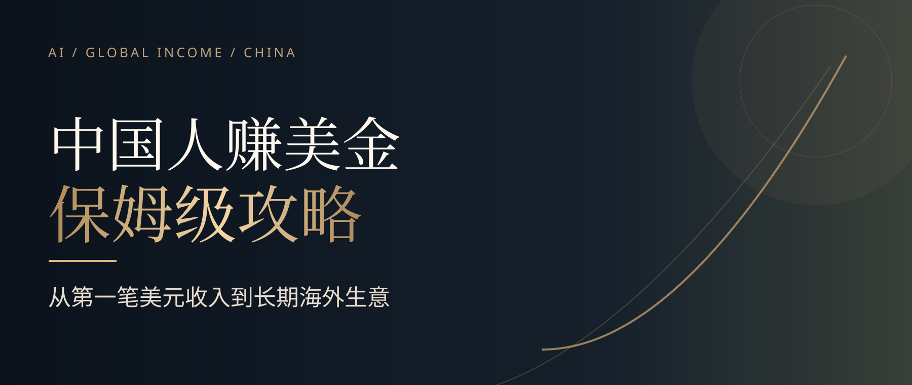

# 中国人赚美金保姆级攻略

  
  
  
  

<strong>一个中国人，一台电脑，怎样从第一笔真实美元订单做成长期生意</strong>

**[🌐 在线阅读](https://aipmandy.github.io/how-to-earn-usd-from-china/)** ｜ **[📖 全文指南](GUIDE.md)** ｜ **[💵 收款与税务](docs/02-payment-tax.md)** ｜ **[📨 英文获客模板](examples/outreach-messages.md)** ｜ **[English](README_EN.md)**

我做过多年 AI 产品，目前也在做职业咨询、内容和海外业务。国内有很多人具备专业经验，却不知道怎样把这项能力卖给海外客户。我把起步时最容易卡住的环节整理成一份指南。

这份攻略直接回答五个问题。**卖什么、客户在哪、怎么报价、怎样交付、钱怎么合法收回来。**

我认为更适合普通人的顺序是先用现有能力提供服务，拿到真实订单，再考虑内容、产品、SaaS 和团队扩张。平台收入、跨境收款规则会变化，关键事实在文末保留官方出处。

> **读完你能拿走的东西** 8 条业务方向、服务与报价表、客户触达示例、交付清单、收款凭证清单，以及官方资料索引。所有价格和订单情景示例都会明确标注，不提供收入保证。

## v2 完整执行版 — 读完直接知道下一步

**我已经把原先的十章扩展为十六章。** 新增按身份选择美元收入路线、第一单七步成交、30 天逐日执行表、交付文件清单，以及八类失败情形。价格与日期仅为演示，成交不保证。

| 你的问题 | 直接看答案 |
|---|---|
| 我应该卖什么、现在适合哪条路 | [按职业经验选择路线](docs/choose-your-path.md) |
| 第一笔美元订单具体怎么跑通 | [七步成交与交付](docs/first-dollar.md) |
| 每天需要做什么 | [30 天逐日行动安排](docs/30-day-plan.md) |
| 报价、合同、收款需保留什么 | [五份交付与资金文件](docs/deliver-payment.md) |
| 哪些做法容易踩坑 | [八类常见失败情形](docs/avoid-pitfalls.md) |

**[🌐 体验玻璃质感新版网站](https://aipmandy.github.io/how-to-earn-usd-from-china/)** · **[📖 在线阅读完整 16 章](https://aipmandy.github.io/how-to-earn-usd-from-china/article.html)**

## 从这里开始

| 你现在最需要什么 | 直接看哪里 | 读完能解决什么 |
|---|---|---|
| 还不知道做哪门生意 | [八条可选业务](docs/01-business-paths.md) | 按已有职业经验选择服务 |
| 想获得第一位海外客户 | [客户与交付指南](docs/03-customers-and-delivery.md) | 从询价到交付的具体步骤 |
| 需要可复制的英文沟通内容 | [英文私信与报价](examples/outreach-messages.md) | 联系客户、回复需求、确认范围 |
| 正在谈第一笔项目 | [第一单交付清单](templates/first-order-checklist.md) | 避免报价、验收、付款遗漏 |
| 不清楚美元怎么收 | [收款与税务](docs/02-payment-tax.md) | 区分个人、企业、平台与银行路径 |
| 需要留存交易证明 | [收款材料清单](templates/payment-records.md) | 整理合同、付款、结汇与申报凭证 |
| 想核验平台或政策 | [官方来源索引](docs/SOURCES.md) | 直接查支持地区、外汇和税务原文 |
| 想先看结论 | [全文 10 章](GUIDE.md) | 理解从起步到长期业务的完整路线 |

## 八条美元收入路线

| 路线 | 更适合谁 | 起步可交付成果 |
|---|---|---|
| 专业咨询 | 产品、职业顾问、行业专家 | 一次诊断与具体改进建议 |
| AI 自动化与开发 | AI 产品、程序员、小团队 | 一个能运行、能验收的业务流程 |
| 设计与视频 | 设计师、剪辑师 | 一套视觉稿、落地页或视频 |
| 内容与增长 | 运营、SEO 从业者 | 内容诊断、计划与实际交付 |
| 中国供应链协助 | 制造、外贸、采购人员 | 供应商资料、样品与跟单支持 |
| 行业本地化 | 双语且懂行业的人 | 产品文档、软件和技术资料 |
| 数字产品 | 有可复用专业知识的人 | 模板、资料包、课程、小工具 |
| 小型 SaaS | 能长期维护产品的团队 | 可持续服务的软件和订阅产品 |

## 我为什么建议先接服务，再做产品

刚开始通常不缺工具，缺的是明确需求、真实客户和能收到的款项。先用自己熟悉的专业能力完成小订单，往后更容易判断哪些交付值得做成课程、工具或订阅业务。没有订单时，先解决客户和报价问题；有订单以后，再解决复购和规模化。

海外客户付美元，不意味着你可以忽略中国的外汇、税务、合同和个人信息保护要求。**支付工具支持地区、平台提现资格和结汇材料，请以真实主体和官方最新规则为准。**

## 下载、引用与参与贡献

- [贡献说明](CONTRIBUTING.md) · [提交实际案例](https://github.com/AIPMAndy/how-to-earn-usd-from-china/issues/new/choose) · [纠正过期政策](https://github.com/AIPMAndy/how-to-earn-usd-from-china/issues/new/choose)
- [更新记录](CHANGELOG.md) · [常见问题](docs/FAQ.md) · [证据与来源](docs/SOURCES.md)
- 分享这份攻略，可以直接转发[网站](https://aipmandy.github.io/how-to-earn-usd-from-china/)或 GitHub 仓库。如果它帮你省去了查资料的时间，欢迎点 **Star**，也欢迎补充经授权、可核实的真实经验。

请勿在 Issue 里公开客户姓名、订单号、银行账户、公司内部数据及隐私信息。案例中的客户、金额和截图只在得到许可后使用。项目目前暂未选择商业再利用许可，相关说明见 [LICENSE-CHOICES.md](LICENSE-CHOICES.md)。

## 关于作者

**AI 酋长 Andy**，曾在腾讯、百度从事 AI 产品相关工作，持续研究 AI 产品、职业成长和海外业务。

个人网站 [metaver.vip](https://metaver.vip/) · [咨询与 AI 陪跑](https://metaver.vip/services) · 微信 **AIPMAndy**

维护时间 2026-10-18。平台政策和支持范围会变动，重要决定前请到官方页面重新确认。
