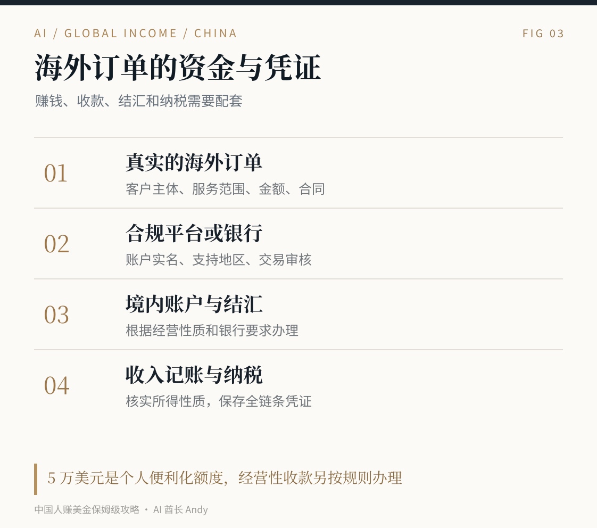

# 中国大陆主体怎样处理跨境收款与税务

## 五、钱怎么收回来，这一段必须先看

我把收款分成三种常见情况。**海外平台结算、海外客户直接付款、网站卖数字产品。** 这三种业务的账户要求和材料未必相同。

### 情况一，海外接单平台付款

如果通过 Upwork 成交，先完成平台身份认证，进入提现设置，看能用哪些方式。它的官方说明列出了中国本地银行人民币提现，通常也可能有 Payoneer 或 PayPal 等选项。不同币种和渠道会产生手续费与换汇成本。提现账户姓名要与验证资料匹配。

Fiverr 的提现方式包括部分账户可用的 PayPal、银行转账经 Payoneer、Payoneer 账户等，具体还受国家和账户条件限制。千万别先接了一大单，项目结束以后才发现自己提现不符合条件。

### 情况二，海外企业直接付款

如果已经有国内依法注册的公司，可以让客户通过银行国际汇款或符合企业资质的跨境支付渠道付款。最好使用正式合同、企业发票与企业账户，根据银行的真实交易审核提交服务内容、合同、发票及相关交付记录。

PayPal 中国提供面向中国商户的跨境人民币收款路径；Payoneer 也有面向合资格境内个人或商户的跨境贸易收款与结算服务。具体申请资格、业务范围和手续费以各自服务协议及账户为准。<https://www.paypal.cn/portal/merchant/rmb-transfer> <https://www.payoneer.cn/service-agreement/>

如果目前只是个人接一两次零散服务，也可以向自己的银行和平台确认符合真实业务的个人收款方式。业务连续发生、开始有长期客户后，建议尽早明确经营主体和税务处理。

### 情况三，网站卖软件或数字产品

这里很多人会碰到 Stripe。**Stripe 的正式支持国家与地区列表目前包括香港、美国等地，不包括中国大陆。** 不能因为自己有美国 IP，就填写一个没有真实权利使用的美国公司或地址。

部分数字商品平台提供代收付款，但注册地区、身份证明、可提款国家和支付方式会变化。Gumroad 明确不支持以 Payoneer 或 Wise 作为创作者提款替代方案；部分国家需要 PayPal 提现。Lemon Squeezy 等平台也要单独检查支持的卖家地区和提款条件，不能只看它们能收美国客户的信用卡。<https://stripe.com/global> <https://gumroad.com/help/article/223-payoneer-and-gumroad> <https://docs.lemonsqueezy.com/help/getting-started/supported-countries>

有人会考虑注册美国公司。它可能是业务发展的方案，但注册费只是一小部分。公司还有州年度费用、税务申报、银行要求、注册代理和维护成本。Stripe Atlas 官方目前标价 500 美元注册费，后续可能有每年注册代理等费用。**客户还没成交时，不建议先把时间都花在注册美国 LLC 上。** <https://stripe.com/atlas>

### 个人每年只能收 5 万美元吗

国家外汇管理局明确，等值 5 万美元是个人结售汇的**年度便利化额度**，并非真实合法的经常项目结汇金额绝对上限。超出额度或需要不占额度办理时，可根据具体交易提供真实材料。经营性外汇收支与普通非经营性收入要区分，不能把商业收款拆成家人多个账户来规避审核。<https://www.safe.gov.cn/ningxia/2022/0929/1997.html>

我建议第一笔海外业务就留好合同、发票或付款凭证、客户邮件、交付记录和账户流水。以后客户变多、业务金额变大，这些材料会直接影响收款效率。

## 六、税务怎么处理，赚美元也要算这笔账

先区分两个概念。**客户来自美国**，不意味着这笔钱在中国税务上必然属于境外来源所得。个人如果人在中国境内提供劳动、履约或服务，相关所得在适用规则下可能属于中国境内来源所得，和客户从哪里打款是不同的判断。个人所得税法实施条例第三条明确了在中国境内提供劳务的所得来源规则。<https://www.chinatax.gov.cn/n810219/n810744/n3752930/n3752974/c3963364/content.html>

你赚的是工资、劳务报酬、个人经营所得、稿酬还是公司营业收入，会影响申报方式。中国税收居民的境内外所得也要按适用规定处理。对于确实属于居民个人的境外所得，政策规定取得所得的次年 3 月 1 日至 6 月 30 日申报；经营所得还有不同申报与预缴安排。<https://www.chinatax.gov.cn/chinatax/n810219/n810744/n3752930/n3752974/c5143076/content.html>

企业出口软件、设计等服务，符合条件的业务有机会适用增值税零税率或跨境免税政策，但必须符合服务性质、境外消费、申报材料等具体要求，不能因为客户在美国就自动当成零税率。2026 年税务机关的相关解释可在官方渠道查到。<https://liaoning.chinatax.gov.cn/art/2026/7/13/art_782_172991.html>

我的建议非常实际。第一笔收入就单独记账。把付款主体、服务内容、订单金额、平台费用、实际到账、开票情况、发生地点与对应凭证记清楚。如果已经稳定经营，找了解跨境服务的会计核对主体和纳税事项。别通过虚报居住地、购买所谓免税账户来处理这件事。

---
更多资料见 [完整指南](../GUIDE.md)。